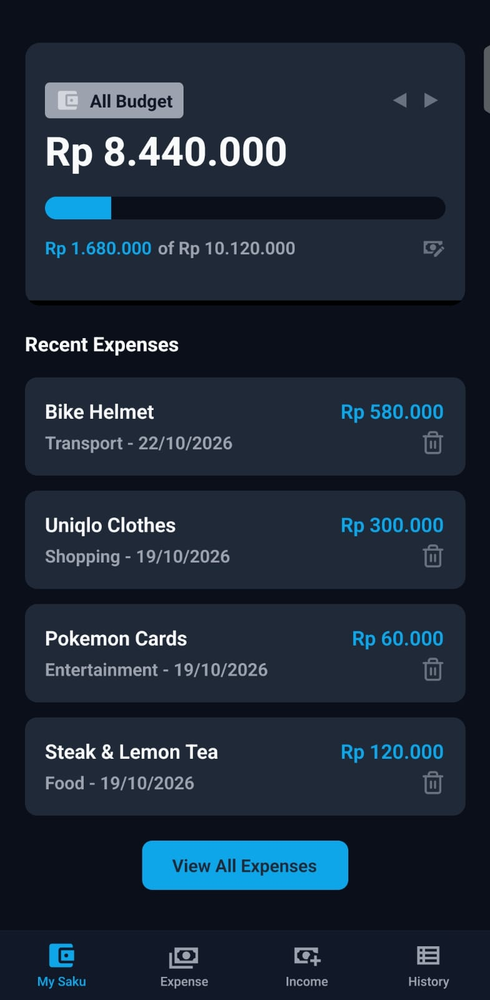
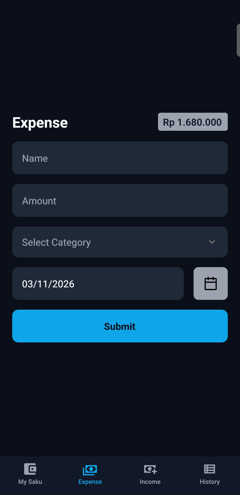
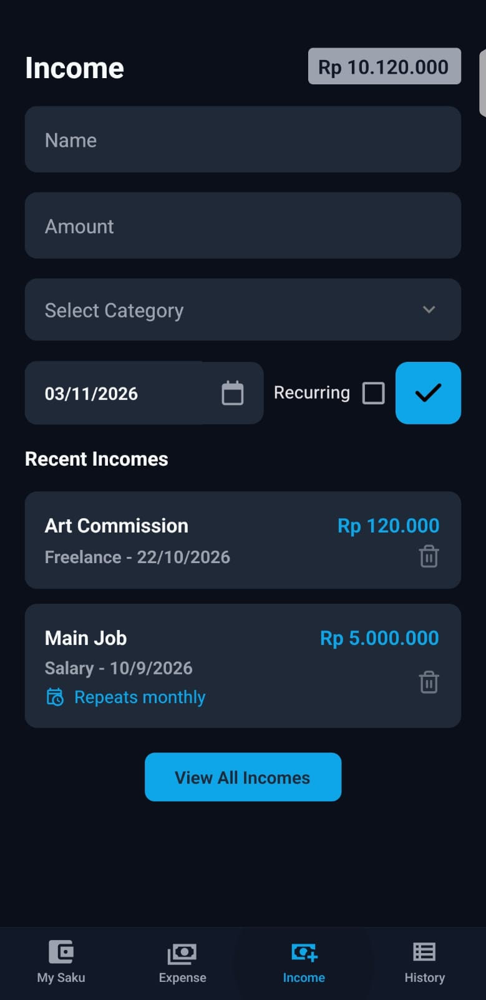
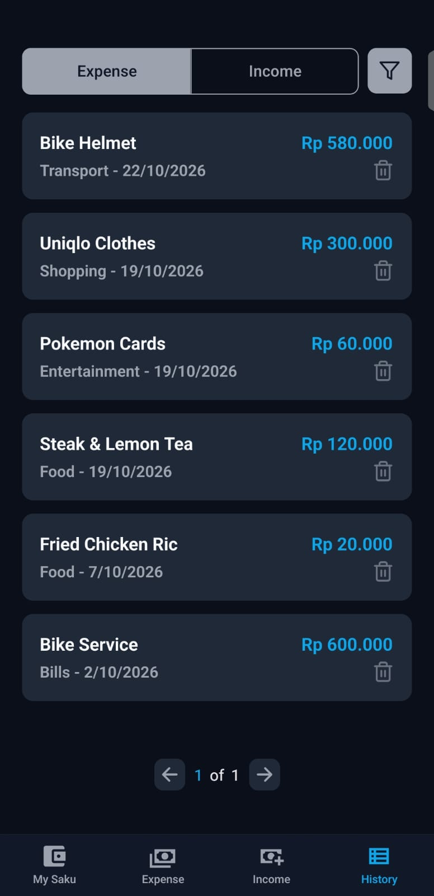

# Sakuly

A simple personal budget tracker built with React Native and Expo. Track your income and expenses, see how much of your budget is left each month, and set up recurring income that updates automatically.

<p>
  
  
  
  
</p>

## Features

- **Income and expense tracking**: add entries with a name, amount, category and date
- **Recurring income**: choose one-time, daily, weekly, monthly or yearly, and the total earned updates as time passes
- **Monthly budget card**: see your remaining budget and a progress bar for any month, with previous/next navigation
- **All-time view**: toggle the wallet icon to see your budget across all months
- **History**: browse past expenses and income with pagination, and filter by all, this month, last month or category
- **Offline**: all data is stored locally on your device

## Tech stack

- React Native and Expo
- [React Native Paper](https://callstack.github.io/react-native-paper/) for UI components
- [Zustand](https://github.com/pmndrs/zustand) for shared state
- AsyncStorage for local storage

## Getting started

### Prerequisites

- Node.js (LTS)
- The [Expo Go](https://expo.dev/go) app on your phone, or an Android/iOS emulator

### Install and run

```bash
git clone https://github.com/hisyamap/Sakuly-app
cd Sakuly-app
npm install
npx expo start
```

Then scan the QR code with Expo Go, or press `a` (Android) or `i` (iOS) to open an emulator.